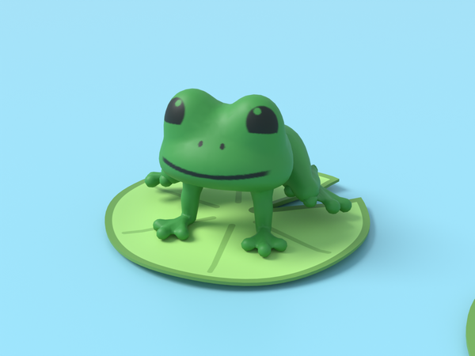
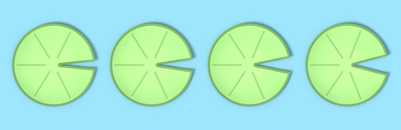
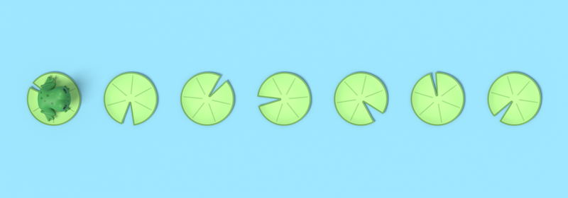
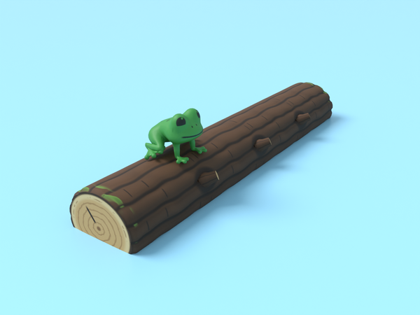
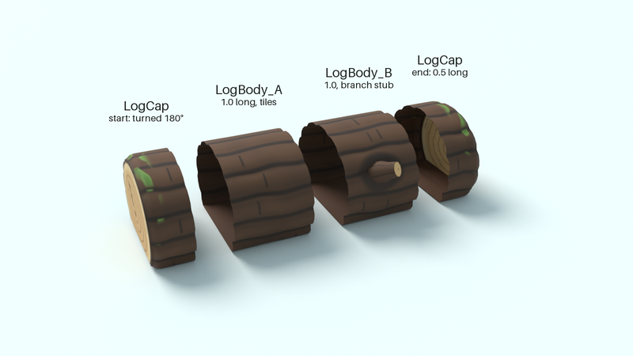
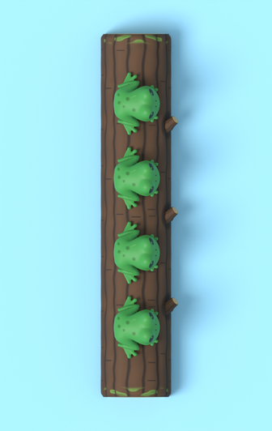
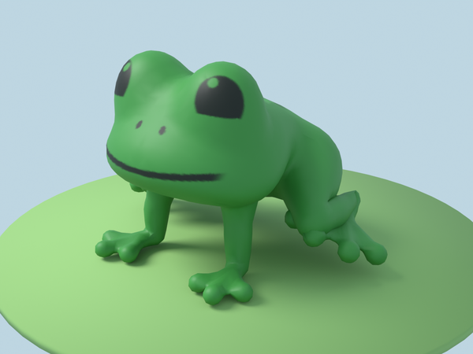
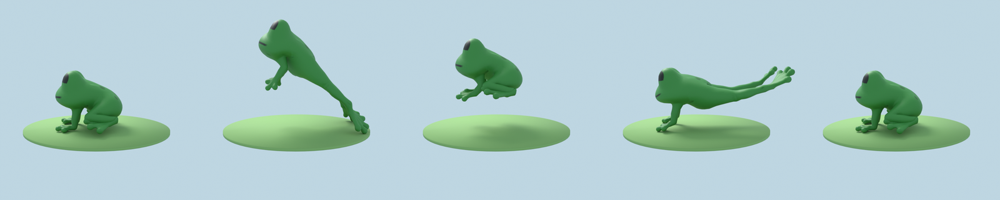

# Game board

The pond. Every frog's lane, whose turn it is, and the button that starts a
turn. This is the screen the game lives on — everything else is something that
opens on top of it.

## Invariants

**Invariant:** every frog in the game is visible at once, on its own lane,
without scrolling. Four lanes is the maximum and the layout is designed for
four; it never pages, pans, or zooms.
**Invariant:** frogs never share a lane and never interact. A player's entire
state is how far up their own lane they are — see
[the reference material](../reference/index.md#frogs-are-independent).
**Invariant:** the Start log and the End log are **one drawing over separate
positions**. There is one of each on the board however many frogs are playing,
and every frog's position 0 and position 8 are on them. Two frogs on the Start
log are not sharing a space: each is on position 0 *of its own lane*, drawn on
its own lane's centre line, and neither can be moved, blocked, or read off by
the other. The shared log is the only thing on this screen a player could
mistake for frogs sharing something, which is why it is written down here.
**Invariant:** no *piece* on the board moves on its own — not a frog, a lily pad
or a log. A frog moves only as the direct result of the answer the player just
gave. The water's slow drift ([PW-3](#pw-3)) is the backdrop, not a piece, and is
the one exception.
**Invariant:** whose turn it is is stated in words in the header, not only shown
by a highlight. Since
[#326](https://github.com/derekwinters/connor-multiplying-frogs/issues/326) the
words are the *only* thing in the header that says it, so this invariant is no
longer a floor the layout comfortably clears — it is the layout. Nothing may
remove those words in favour of a colour, a ring, or an arrow.
**Invariant:** `Roll` is the only way to start a turn, and it is disabled the
moment it is pressed until the turn resolves. A double-tap cannot roll twice.
**Invariant:** nothing on this screen is destructive. Ending the game lives
behind the settings button and a confirm — see
[settings dialog](settings-dialog.md).

## Regions

| Region | Job |
| --- | --- |
| `header` | Whose turn it is, and the settings button |
| `pond` | The lanes — one per frog in the game — and the two logs they share |
| `controls` | The `Roll` button |

The pond, in turn, is:

| Part | Job |
| --- | --- |
| `start-log` | **One** log down the left of the pond, spanning the whole pond band. It is position 0 of every lane |
| `lane` × 2–4 | One per frog in the game, stacked |
| `end-log` | **One** log down the right of the pond, spanning the whole pond band. It is position 8 of every lane |

A lane, in turn, is:

| Part | Job |
| --- | --- |
| `chip` | Which frog this lane belongs to, and how far it has got |
| `track` | Seven lily pads — this lane's positions 1–7 |
| `piece` | The frog itself, sitting on its current position — one of its own lily pads, or the shared log at either end |

The logs are parts of the **pond**, not parts of a lane. That is the whole of
this layout change: a four-frog game draws two logs, not eight.

## Anchors

The three regions are horizontal bands that together fill the full 1200 px
height, in this order and with no gaps:

- `header` — pinned to the top, `BoardHeaderHeight` tall, full width.
- `pond` — everything between the other two bands. Lanes are stacked and
  **vertically centred** within it, so a two-frog game is centred rather than
  clinging to the top.
- `controls` — pinned to the bottom, `BoardControlsHeight` tall, full width.

"Full width" and "the top" mean the screen's, not the reference canvas's, on a
device that is not 16:10 — a band reaches the edges the way the water does.

What the bands *contain* divides in two, and this is the division
[#325](https://github.com/derekwinters/connor-multiplying-frogs/issues/325)
introduced:

- **`header` and `controls` are measured in the reference canvas.** The turn
  banner, the gear and `Roll` are anchored controls, and a wider screen moves
  the two that are anchored to an edge without resizing any of them.
- **The `pond` is measured in the screen.** Its row is a track whose job is to
  show how far along a lane a frog has got, so it spreads to whatever width it
  is given — see [across the pond](#anchors) below.

Every number in the tables below is still in reference-canvas units, and every
one of them still means exactly what it says. `LanePositionGap` is the single
exception, and it is derived rather than typed.

The whole of that rule, and the one control it moves, is
[the bands reach the edges too](#the-bands-reach-the-edges-too).

Across the pond, the nine positions occupy the same nine columns in every lane,
and **the row spans the whole screen** — the chips and the Start log against the
real left safe margin, the End log against the real right one, and the seven
lily pads spread evenly in whatever is left between them:

- `chip` — pinned to the **left** safe margin, `LaneGutterWidth` wide. It does
  not stretch; see [why the gutter does not
  stretch](#why-the-gutter-does-not-stretch).
- `start-log` — `LaneGutterGap` to the right of the chips. Everything to the
  left of its right-hand edge is fixed, so the Start log sits at the same x on
  every screen.
- `track` — this lane's seven lily pads, `LanePositionGap` from the Start log,
  from each other, and from the End log. That gap is **derived from the screen's
  width**, not typed into the table.
- `end-log` — pinned to the **right** edge of the safe area.

`LanePositionGap` is the one number on this page that the screen decides:

```text
LanePositionGap = max( LanePositionGapMin, (screen width − LaneFixedWidth) ÷ LanePositionGapCount )
```

`LaneFixedWidth` is everything on the row that does not stretch, and
`LanePositionGapCount` is the number of gaps the slack is divided between —
one either side of the pads, six among them. Both are in
[the constants table](#named-constants), and the arithmetic that produces them
is [worked through there](#the-horizontal-arithmetic).

**At exactly 1920 px the formula gives exactly 48 px**, which was
`LanePositionGap`'s typed value before this change. That is not a coincidence to
be grateful for — it is the condition this rule was chosen to satisfy, so that
the reference canvas keeps being a picture of the game. It is checked rather
than assumed, in both drawings and in the build: [the mockup renders
byte-identical](#mockup) at 1920 before and after, and since
[#408](https://github.com/derekwinters/connor-multiplying-frogs/issues/408) the
built board is held to the same picture — an EditMode test asserts where every
one of a lane's nine positions lands, at 1920 and at 2560, against the numbers
the two mockups draw them at rather than against the formula above.

The floor is what a *narrower* screen gets. Below 1920 px the formula would
start closing the pads up, so it stops: the board keeps its reference width and
is centred, exactly as it always was. **The pond spreads on screens wider than
16:10 and is unchanged on everything else.**

Both logs are `SharedLogHeight` tall, which is the height of the `pond` band on
the reference canvas: they fill it, edge to edge with the two hairlines, whether
two frogs are playing or four. Every lane's centre line therefore crosses both
of them, and a frog on a log still sits on its own lane's line. A shorter screen
loses height from `pond` and nothing else — and the logs lose it with the band,
because they are the band's height rather than a number typed in beside it. The
header and the controls do not shrink, because a smaller `Roll` button is the
wrong thing to trade away.

A *taller* screen is the other side of that, and it is not symmetric: the extra
height is all `pond`, and it is all water. The logs and the lane stack stay
their reference size, centred in the band, because they are the board rather
than the backdrop — see
[the bands reach the edges too](#the-bands-reach-the-edges-too).

## Why the lanes run across

The classroom board's lanes run bottom to top. This one's run left to right, and
that is a deliberate rotation rather than an oversight.

Both were drawn and compared:

| | **Lanes across** (built) | **Lanes up** (rejected) |
| --- | --- | --- |
| Lane runs | Left to right | Bottom to top |
| Lily pad diameter | **112 px** | **64 px** |
| Frog piece | 88 px | 52 px |
| Looks like the cardboard board | No — it is rotated | Yes |
| Reads as progress | Yes — left to right, like a race | Less so on a wide screen |
| Space used | Fills a 16:10 screen | Four tall columns with wide margins |

The deciding number is the pad size. Nine positions have to fit along the lane;
laid out across a 1920-wide screen that gives a 112 px lily pad, and stood up
against a 1200-tall one it gives 64 px. The lily pad is the thing a child looks
at to see how they are doing, and standing the board up costs nearly half of it.

Under [ADR-0001](../../adr/0001-rules-sacred-presentation-ours.md) the board's
orientation is presentation, not a rule, so it is ours to change. **Derek chose
lanes-across** after seeing both drawn.

## Named constants

| Element | Constant | Value |
| --- | --- | --- |
| Safe margin | `SafeMargin` | 48 px |
| Header band height | `BoardHeaderHeight` | 128 px |
| Controls band height | `BoardControlsHeight` | 176 px |
| Hairline under `header`, over `controls` | `BoardBandOutline` | 3 px |
| Turn banner text size | `TurnBannerSize` | 52 px |
| Settings button, square | `SettingsButtonSize` | 96 px |
| Settings gear glyph size | `SettingsGlyphSize` | 96 px |
| `Roll` button width | `RollButtonWidth` | 480 px |
| `Roll` button height | `RollButtonHeight` | 144 px |
| `Roll` label size | `RollButtonLabelSize` | 56 px |
| Frog hop duration | `FrogHopDuration` | 0.5 s |
| The water's tile | `PondWaterTile` | `Assets/Art/Water/Resources/Water/pond_water_tile.png`, 512 px — see [the water's marks](#the-waters-marks) |
| How fast the water drifts left | `PondWaterDriftSpeed` | 25 px/s |
| How big one tile is drawn | `PondWaterTileSize` | 1024 px — the approved preview's scale; can be retuned |
| Lanes in play | `LaneCount` | 2–4 — one per frog in the game |
| Positions in a lane | `LanePositionCount` | 9 |
| Correct answers needed to win | `LaneWinningPosition` | 8 |

`LanePositionCount` is 9 because a lane is the Start log, seven lily pads, and
the End log, and **the End log is the winning space** — a frog has to land on
it. Confirmed by Derek in
[issue #185](https://github.com/derekwinters/connor-multiplying-frogs/issues/185);
recorded in
[the reference material](../reference/index.md#the-end-log-is-the-winning-space).
That is what the `of 8` in every chip's pad count refers to. Drawing the two
logs once for the whole pond does not change that count: a lane is still nine
positions, and two of them are now drawn on something the lane shares.

`LaneCount` is the only quantity on this page that is not fixed at design time.
It sizes the lane stack — `LaneCount × LaneHeight`, centred in the pond — and
nothing else. In particular it does **not** size the logs: they fill the pond
band whatever it is.

The lane:

| Element | Constant | Value |
| --- | --- | --- |
| Lane band height | `LaneHeight` | 184 px |
| Lily pad diameter | `LilyPadDiameter` | 112 px |
| Notch depth, as a fraction of the radius | `LilyPadNotchDepth` | 0.15 |
| Notch widths in the variation table | `LilyPadNotchAngles` | 10°, 15°, 20°, 25° |
| Veins per pad | `LilyPadVeinCount` | 5 |
| Vein gap at the centre, fraction of the radius | `LilyPadVeinInset` | 0.20 |
| Vein gap at the rim, fraction of the radius | `LilyPadVeinOutset` | 0.12 |
| Vein stroke | `LilyPadVeinWidth` | 2.5 px |
| Vein opacity, drawn in `LilyPadEdge` | `LilyPadVeinOpacity` | 0.5 |
| Frog piece diameter | `FrogPieceDiameter` | 88 px |
| Frog piece outline | `FrogPieceOutline` | 4 px |
| Lily pad outline | `TrackOutline` | 3 px |
| Gap between positions | `LanePositionGap` | derived — see [Anchors](#anchors) |
| Smallest that gap may be | `LanePositionGapMin` | 48 px |
| Everything on the row that does not stretch | `LaneFixedWidth` | 1536 px |
| Gaps the leftover width is divided between | `LanePositionGapCount` | 8 |
| Chip gutter width | `LaneGutterWidth` | 256 px |
| Gap between chip and track | `LaneGutterGap` | 48 px |

### The lily pad is notched, veined, and varies per pad

A pad is a circle with a wedge cut from it and five veins across it. Both the
notch's **width** and the direction it **points** vary from pad to pad, so a
four-frog board draws 28 pads that are not 28 identical discs.

Since
[#465](https://github.com/derekwinters/connor-multiplying-frogs/issues/465)
every pad is **the approved 3D lily pad model** — a model built in Blender,
which Derek turned round in a 3D viewer and said looks good and should go in
the game. It replaced the generated 2D sprite **at the same footprint**, and
everything in this section is still what decides which pad goes where. What
moved is who draws the notch and the veins: they are in the model now, built to
the numbers below by its script, rather than drawn by the game. See
[the lily pad model](#the-lily-pad-model) for what it must do.

**The variation is a pure function of where the pad is.** A twelve-entry table,
indexed by the pad's own coordinates:

```text
index = (lane × 5 + position) mod 12
```

| # | Notch | Points at | | # | Notch | Points at |
| --- | --- | --- | --- | --- | --- | --- |
| 0 | 20° | 14° | | 6 | 10° | 260° |
| 1 | 10° | 212° | | 7 | 15° | 131° |
| 2 | 25° | 96° | | 8 | 25° | 341° |
| 3 | 15° | 308° | | 9 | 15° | 78° |
| 4 | 20° | 175° | | 10 | 20° | 238° |
| 5 | 25° | 47° | | 11 | 10° | 158° |

Angles are measured the way the mockup's SVG measures them: 0° points right
along the lane, 90° points down. **The `Notch` column is the wedge's angular
width**, so its two ends sit half of it either side of the direction the pad
points at; `LilyPadNotchDepth` is where the wedge's apex is, measured **out
from the centre** — 0.15 of the radius, so the cut crosses most of the pad and
stops just short of the middle. The `× 5` offset exists so the four lanes do
not line up into visible columns; the rotations span the whole circle rather
than clustering, because an earlier draft confined them to the bottom
semicircle and read as "all the notches point down at slightly different
angles", which is not variation.

**Being derived rather than random is the whole design, and it buys four
things:**

- **Nothing is stored and nothing is saved.** A random-per-game variation would
  have to persist, or a resumed game would come back with differently shaped
  pads — and the save format is Core's under
  [ADR-0004](../../adr/0004-core-owns-the-save-format.md), so that would be a
  schema change and a migration for a cosmetic detail.
- **A pad never changes shape** when the board redraws, when a frog hops, or
  between devices and runs.
- **Rotation is free at runtime** — you rotate the transform. So the
  implementation needs **four pads, one per entry in `LilyPadNotchAngles`**,
  not twelve. That held for the four generated sprites, and it holds for the
  model, which is four meshes for exactly this reason.
- It is **presentation, not game logic**, so it belongs in the Unity layer
  rather than Core — but it is a static pure function and is testable as one.

**The veins below are painted into the model's albedo** by
`tools/art/lilypad_model.py`, from these same constants, and
`GameBoardLilyPadTests` reads them back out of the committed texture. Changing
one of them is a change to that script and to the texture it bakes, not to the
game's code.

**The veins radiate from the circle's geometric centre**, not from the notch's
apex. The notch stopping short of the diameter is the notch's business; the
veins ignore it. Drawn from the apex the fan sits off-centre and leans
differently on every pad, which is what made an earlier draft look uneven.

The five are **symmetric about the notch's own axis**, so one vein runs straight
out opposite the notch and two pairs sit either side of it. An even count
straddles that line and reads less like a leaf. Each vein stops short at both
ends — `LilyPadVeinInset` at the centre so the five do not converge into a dark
hub, and `LilyPadVeinOutset` at the rim.

**The five veins and the notch divide the circle into six equal parts.**
Consecutive veins are `(360° − notch) ÷ 6` apart, and the outermost vein on
each side clears the notch's edge by that same angle — so a pad reads as evenly
leafed whichever of the four notch widths it has. This is what the mockup
draws; it is written down here because it is the one thing about the fan that
"five, symmetric, one opposite the notch" does not already fix, and an
implementation that spaced them any other way would satisfy every sentence
above it and still be a different drawing.

**None of this changes `LilyPadDiameter`.** 112 px is the number that
[decided lanes-across over lanes-up](#why-the-lanes-run-across); only the
outline and the surface moved — and, with #465, what they are drawn with. And note that a frog covers all but a 12 px ring
of the pad it sits on, so the veins and most of the notch are visible on
**empty** pads — which is most of the board, but never the pad being looked at.

#### The lily pad model







These are the modelling script's own preview renders, lit in Blender. On the
board a pad is seen from straight above, like the last two, and drawn in its
albedo without a light ([LP-4](#lp-4)).

- **LP-1 — The approved model, unchanged.** <a id="lp-1"></a> The pads are
  `tools/art/lilypad_model.py`'s output, imported as it is: **four meshes**,
  `LilyPad_Notch10`, `LilyPad_Notch15`, `LilyPad_Notch20` and
  `LilyPad_Notch25` (about 2,300 triangles each), one per entry in
  `LilyPadNotchAngles`, sharing **one 2048 px albedo atlas** — a quadrant per
  notch width. Nothing in the game reshapes them. To change how a pad looks,
  change the script, run it again, and replace the imported files.
- **LP-2 — Same footprint.** <a id="lp-2"></a> A pad's rim touches the edges
  of its `LilyPadDiameter` square and goes no further, centred on its position,
  exactly where the sprite was.
- **LP-3 — Pointed by the table.** <a id="lp-3"></a> Each mesh is drawn with its
  notch along its own +x — the table's 0° — and the pad is turned by the
  table's angle, as the sprite was. Which way the model's notch points, and
  which way is up, are **read off the model's own outline** (the widest gap in
  its rim; its thin axis, the way its rim curls), not assumed from the
  importer's axis conversion.
- **LP-4 — Its own colours, untinted and unlit.** <a id="lp-4"></a> A pad is
  not a player's colour, so the albedo is drawn exactly as it is: `LilyPadEdge`
  rim `TrackOutline` wide, five veins in `LilyPadEdge` at `LilyPadVeinOpacity`,
  and a fill of `LilyPadGreen` **lightened by up to 4% towards the middle and
  darkened by up to 6% towards the rim** — the falloff the approved model
  paints so the leaf does not read as a flat disc. From straight above, only
  the top of the leaf shows, and no light is added on top of the albedo.
- **LP-5 — Drawn into the board's canvas.** <a id="lp-5"></a> Like the
  [frog piece](#the-frog-piece) (FP-9): each mesh is laid flat once, its
  upward faces handed to uGUI lowest first, with the albedo as the texture and
  uGUI's default material — no camera, light, render texture or project
  shader.
- **LP-6 — Imported by code.** <a id="lp-6"></a> The model's import settings
  are set in code and read back by a test — see
  [tech stack § The lily pad model](../../engineering/tech-stack.md#the-lily-pad-model).

**Invariant:** four meshes, never twelve. The pointing angle is a rotation of
the pad's rectangle; a fifth mesh, or a mesh per row of the table, means the
variation has stopped being a rotation.
**Invariant:** which mesh a pad draws and how far it is turned are the table's,
a pure function of the pad's coordinates, exactly as above. The model changes
what a pad looks like, never which pad is where.
**Invariant:** the pad's colours are the albedo's. The game never tints,
lights or recolours a pad, so the colours the separability bar below is
measured against are the colours on the screen. Whether the falloff's darkest
ring may sit below that bar is
[#466](https://github.com/derekwinters/connor-multiplying-frogs/issues/466),
open.

The two shared logs. They belong to the pond, so they are their own table:

| Element | Constant | Value |
| --- | --- | --- |
| Log width | `LogWidth` | 176 px |
| Log height | `SharedLogHeight` | 896 px — `1200 − BoardHeaderHeight − BoardControlsHeight` |
| `Start` / `End` text size | `LogLabelSize` | 26 px |
| How far below the log's top edge that word starts | `LogLabelTopPadding` | 28 px |

`TrackOutline` is **not** in this table, and that is the change rather than an
omission: the log has no rim, so it draws no outline at any width. It is the
lily pad's constant now. The two label rows are the mockup's `.log` rule read
back as named values — the log was drawing no word at all before
[#301](https://github.com/derekwinters/connor-multiplying-frogs/issues/301)
moved it to the top, so neither number had anywhere to live.

`LogLabelTopPadding` is measured from the log's own top edge, not from the pond
band's. The two are the same line at the reference canvas and would stop being
so the moment a log were ever inset in its band, and it is the log the word
belongs to.

`LogHeight` (120 px) is **gone**, not renamed to something with the same
meaning. It was the height of a log sized to sit inside one 184 px lane, and
there is no such thing on this board any more.

`SharedLogHeight` is **one number, not an expression**: the log spans the full
pond, so it is 896 px at two frogs, at three, and at four. That is Derek's
answer, on
[issue #296](https://github.com/derekwinters/connor-multiplying-frogs/issues/296),
to the question this page used to leave open — "log spans full lane space
regardless of player count" — and it is the option the mockup did *not*
originally draw. A two-frog game gets a full-height log with open water above
and below its two lanes, and the board's ends do not change size when a player
joins or leaves.

It is written as the band's own arithmetic rather than as the bare 896 because
the log **is** the band: if `BoardHeaderHeight` or `BoardControlsHeight` ever
moves, the logs move with it and nobody has to remember them.

**`LogRadius` (24 px) is gone**, not renamed. It was the corner of the flat
rounded rectangle the log used to be; since
[#468](https://github.com/derekwinters/connor-multiplying-frogs/issues/468)
the log is the approved model below, and its ends are the model's own sawn
caps. That overtakes the last of #296's three answers — *"the corner is the
`LogRadius` it always was"* — the way #301 overtook its outline half.

#### The log model







These are the modelling script's own preview renders, lit in Blender. On the
board a log is seen from straight above, like the last one, and drawn in its
albedo without a light ([LG-4](#lg-4)). Derek approved the model for
[#468](https://github.com/derekwinters/connor-multiplying-frogs/issues/468),
and chose **one big stretched log** for each end of the pond — the layout
above — over a log per player.

- **LG-1 — The approved model, unchanged.** <a id="lg-1"></a> A log is built
  from `tools/art/log_model.py`'s three pieces, imported as they are:
  `LogBody_A` and `LogBody_B`, tileable middle sections exactly one frog unit
  long (B has a small sawn-off branch stub on one side), and `LogCap`, the
  sawn end, half a unit long. They share **one 1024 px albedo**. The file also
  carries two prebuilt assemblies, `SharedLog` and `PlayerLog`; the game does
  not use them. To change how a log looks, change the script, run it again,
  and replace the imported files.
- **LG-2 — Assembled to the log's length.** <a id="lg-2"></a> One frog unit
  is `LilyPadDiameter` (112 px), so a log `SharedLogHeight` tall is
  L = 896 ÷ 112 = 8 units long. It is built by the script's own assembly
  rule: a cap at each end, and between them
  n = max(1, ⌊(L − 2 × 0.5) + 0.5⌋) bodies, each stretched along the log by
  (L − 2 × 0.5) ÷ n, alternating A, B, A… from the bottom. The bottom cap is
  the top one turned half a turn. At the reference canvas that is **seven
  bodies at their own length**. The rule is defined down to L = 1.5 units
  (168 px), where one body is stretched to half its length; below that the
  script says the caps would have to shrink too, which is not decided, so a
  shorter log is refused rather than guessed at.
- **LG-3 — Same rectangle, true scale across.** <a id="lg-3"></a> The model
  runs the full height of its `LogWidth` × `SharedLogHeight` rectangle, bottom
  edge to top edge, centred across it, and is drawn at one frog unit to
  112 px across the log as well as along it — it is not stretched to fill the
  width. The bark is about 174 px across, inside the 176 px rectangle, and
  `LogBody_B`'s stub reaches about 17 px past the rectangle's right-hand edge,
  over the water. Seen from above, the log runs top to bottom and the lanes
  cross it.
- **LG-4 — Its own colours, untinted and unlit.** <a id="lg-4"></a> A log is
  not a player's colour, so the albedo is drawn exactly as it is: bark centred
  on `LogBrown`, lighter plates and a lighter top, dark grooves and cracks, and
  a little moss near each sawn end. From straight above only the top of the
  log shows, and no light is added on top of the albedo.
- **LG-5 — Drawn into the board's canvas.** <a id="lg-5"></a> Like the
  [lily pad](#lp-5): each piece is laid flat once, and every piece of the
  assembly hands its upward faces to uGUI, lowest first across the whole log,
  with the albedo as the texture and uGUI's default material — no camera,
  light, render texture or project shader. Which way along a piece runs and
  which way is up are **read off the piece's own vertices** (along: the axis
  the body lies all on one side of its joining face; up: the way its section
  reaches furthest from the waterline), not assumed from the importer's axis
  conversion.
- **LG-6 — Imported by code.** <a id="lg-6"></a> The model's import settings
  are set in code and read back by a test — see
  [tech stack § The log model](../../engineering/tech-stack.md#the-log-model).
- **LG-7 — The word stays on top, and readable.** <a id="lg-7"></a> `Start`
  and `End` are drawn after the model, over it, in `LogLabelInk`, exactly
  where they were. Under the word the model is lighter than `LogBrown`, so the
  word is measured against the model's own pixels there, not against the
  constant: worst **4.8 : 1** and ΔE **46.5** (against `LogBrown` it was
  6.1 : 1 and 53.0). That still clears the bar the word is held to, and a test
  measures it on the built board.

**Invariant:** three meshes, whatever the length. A log of another length is
the same pieces assembled again by the rule, never a new mesh or a mesh per
length.
**Invariant:** the model changes what a log looks like, never where it is.
Its rectangle — `LogWidth` × `SharedLogHeight`, in the column every lane's
track starts or ends in — is the layout's, exactly as before, and the frogs
still sit on their own lanes' centre lines across it.
**Invariant:** the log's colours are the albedo's. The game never tints,
lights or recolours a log. Its bark is lighter than `LogBrown`, and every frog
is held to the separability bar against the bark itself — which is why
`FrogBlue` moved on
[#469](https://github.com/derekwinters/connor-multiplying-frogs/issues/469)
rather than the albedo; see [keeping the frogs visible](#keeping-the-frogs-visible).

### The horizontal arithmetic

The row used to sum to 1920 px exactly, and the page said so. It still does at
1920 — but it now sums to the screen's width at every width, because one term in
it is the term that absorbs the difference.

Split the row into what is fixed and what stretches:

```text
LaneFixedWidth  =  48 margin + 256 chip gutter + 48 gap
                     + 176 Start log + 7 × 112 pads + 176 End log
                     + 48 margin
                =  1536 px

LanePositionGapCount  =  8      one gap either side of the pads, six among them

LanePositionGap  =  max( 48, (screen width − 1536) ÷ 8 )
```

Checked at the two widths that are drawn:

| Screen | Slack over `LaneFixedWidth` | `LanePositionGap` | Row sums to |
| --- | --- | --- | --- |
| 1920 px — the reference canvas | 384 | **48 px** | 1536 + 8 × 48 = 1920 |
| 2560 px — the wide drawing | 1024 | **128 px** | 1536 + 8 × 128 = 2560 |

`LaneFixedWidth` is written as its own constant rather than left as a sum
nobody can name, because it is now load-bearing: it is the term the elastic gap
is computed against, so a change to `LaneGutterWidth`, `LogWidth`,
`LilyPadDiameter`, `LaneGutterGap` or `SafeMargin` is a change to it. **If a
constant here changes, `LaneFixedWidth` moves with it** — and unlike before,
nothing else has to, because the gap absorbs the difference by construction.
That is the one genuine simplification in this change: the row used to have to
be rebalanced by hand.

Sharing the logs did not disturb this arithmetic and neither does spreading it:
a shared log still stands in the same column its per-lane predecessor did, and
position 0 is still on the Start log at every width.

### Why the gutter does not stretch

`LaneGutterWidth` is 256 px on every screen. Widening it on a wider tablet was
considered — frogs have typed names now, so more room for a long one is a real
benefit — and rejected, because it would make **how much of a name fits depend
on the device**. A name that shows in full on the tablet and truncates on a
narrower screen is a bug that only appears on one person's hardware, which is
the worst kind to be told about.

If 256 px turns out to be too tight for the names Connor types, the fix is to
make it a bigger fixed number, decided once and drawn — not to make it elastic.
That is a separate change and it wants its own issue.

Vertically, the pond band is `1200 − BoardHeaderHeight − BoardControlsHeight` =
896 px, which is `SharedLogHeight` — the logs fill it exactly. Four lanes at
184 px is 736 px, centred with 80 px of water above and below, so at four frogs
the logs stand 80 px proud of the lane stack at each end; at two frogs, 264 px.

Every outline is drawn **inside** the element's own bounds, so `TrackOutline`,
`FrogPieceOutline` and `BoardBandOutline` cost the layout nothing and the
1920 px sum above is unaffected by any of them.

`SettingsGlyphSize` equals `SettingsButtonSize`, and that is the whole of how
the gear is sized: **the gear is as big as the square it is tapped on.** It
used to be 44 px, `ButtonLabelSize`'s number, because it was a glyph sitting
inside a ring and a white disc and had to leave room for them. With those gone
([#321](https://github.com/derekwinters/connor-multiplying-frogs/issues/321))
there is nothing left to leave room for, so it is sized against the tap target
instead — the glyph's own side bearings are what keep the drawn gear clear of
the square's edges. It stays its own constant rather than becoming
`SettingsButtonSize` at the call site, because a future restyle may want a
smaller gear and `SettingsButtonSize` may never shrink: it is
[`MinTouchTarget`](shared-components.md) exactly.

**`SettingsButtonOutline` is gone**, not renamed. It was the width of the ring
around the gear, and there is no ring.

## Colours

The board is a pond. **Blue water, brown logs, green lily pads** — Derek's
decision, in his words, on
[issue #291](https://github.com/derekwinters/connor-multiplying-frogs/issues/291).

| Element | Constant | Value |
| --- | --- | --- |
| The water — the pond, and the whole screen behind it | `PondWater` | `#9FD8F2` |
| Lily pad | `LilyPadGreen` | `#B2E67F` |
| Lily pad rim | `LilyPadEdge` | `#6E9E4A` |
| Log — what the model's albedo is centred on ([LG-4](#lg-4)) | `LogBrown` | `#4A2E1A` |
| `Start` / `End` on a log | `LogLabelInk` | `#C6B49C` |
| Header and controls bands | `BandFill` | `#E2E8E5` |
| Band hairline | `BandEdge` | `#B9C0BD` |
| The board's words | `BoardInk` | `#1E2422` |
| Frog piece outline | `PieceEdge` | black at 35% |

**`LogEdge` is gone.** The log has no rim. On the old tan log the rim did real
work — it was 2.33 : 1 against the water and it was what made a log read as
floating *on* the pond rather than as a hole in it. Against dark chocolate the
log clears the water by 8 : 1 unaided, and a rim darker than the fill measured
1.4 : 1 against it: invisible, and doing nothing that needed doing.

**`LogLabelInk` is new**, and it exists because the log moved. `Start` and `End`
used to be drawn in a mid-brown chosen against a pale tan; on the new log that
is unreadable. They now sit at the **top** of each log rather than its middle,
in a light ink measuring 6.1 : 1 against the fill — and, since the log became
the 3D model, 4.8 : 1 against the model's lightest bark under the word
([LG-7](#lg-7)).

The four frog colours are not here. They are one table for the whole game, on
[shared components](shared-components.md#frog-colours), because a frog is the
same frog on every screen.

`TrackOutline` (3 px), `BoardBandOutline` (3 px) and `FrogPieceOutline` (4 px)
in the tables above are **widths**; the `…Edge` rows here are the colours drawn
at those widths.

### Placeholder, or settled?

**Settled:** the water is blue, the logs are brown, the lily pads are green.
That is a decision, not a proposal, and nothing should quietly walk it back.

**Not settled:** which blue, which brown, which green. The exact hues are a
taste call and they are Connor's — see
[the open questions](#open-questions). The values in the table are the proposal
drawn in the mockups, and they are what the code carries until he has looked at
the board on the tablet. They are honest placeholders in exactly the sense the
[frog colours](shared-components.md#frog-colours) are, and for the same reason.

### The water is the whole screen

`PondWater` is what this screen paints to all four edges of the device, on any
aspect ratio. It is the `pond` band's own fill **and** the paint behind
everything else — the header and controls bands are drawn on top of it, and so
is every lane, log and frog.

Both, and written down as both, because it used to be only the second one: the
`pond` band painted nothing at all and what read as the pond was the screen-wide
paint showing through where the band was not. That is invisible while the two
agree about where the band is, and it is why nobody noticed the band had the
same bug the header and the controls had — see
[the bands reach the edges too](#the-bands-reach-the-edges-too).

That makes the board the one screen that does not paint the app's own
background. Every other screen paints `#EDF1EF`, and so does the scene camera,
which is what shows for the frame before any screen has painted at all. The
rule from
[the canvas every component is measured in](shared-components.md#what-fills-a-screen-that-is-not-1610)
is unchanged and still holds here: nothing behind the canvas is ever visible,
because this screen's own paint reaches the edges.

#### The water's marks

- **PW-1 — One tile, repeated.** <a id="pw-1"></a> The water is drawn as one seamless
  tile, `PondWaterTile`, repeated across every part of the screen that `PondWater`
  paints today, at any aspect ratio. Nowhere on the board shows a seam.
- **PW-2 — Blue under white.** <a id="pw-2"></a> The tile is `PondWater` (#9FD8F2) with
  see-through white marks on it: small arcs in groups of one to three, of mixed
  sizes, at the calm density Derek approved on 2026-11-20. Between the marks,
  the water is exactly `PondWater`.
- **PW-3 — A slow drift left.** <a id="pw-3"></a> The tile slides to the left at
  `PondWaterDriftSpeed` = **25 px per second** on the 1920 × 1200 reference canvas,
  forever, and nothing else about it changes. It loops without a jump.
- **PW-4 — Drift is time, not frames.** <a id="pw-4"></a> How far the water has moved
  is a pure function of elapsed time, computed in Core, so a slow tablet shows the
  same drift as a fast one and the arithmetic is tested without Unity.
- **PW-5 — Behind everything.** <a id="pw-5"></a> The marks are drawn under every lane,
  log, lily pad, frog and band. Nothing is drawn over a piece.

**Invariant:** the water's colour is `PondWater` and only its marks move. The drift
never tints, darkens or lightens the water, so the colour checks in
[How the pond's colours are constrained](#how-the-ponds-colours-are-constrained)
still measure what is on screen.
**Invariant:** the drift never moves a piece. Logs, lily pads and frogs stay exactly
where the layout puts them; only the texture's offset changes.
**Invariant:** the water never takes input. It is not a button, and it never blocks a
tap on anything drawn over it.

One tile is drawn `PondWaterTileSize` (1024 px) across on the reference canvas,
so at `PondWaterDriftSpeed` the pattern comes round again about every 41 s. The
tile is generated by `tools/art/water_tile.py`, so it is regenerated rather than
hand-edited; how it is imported is
[tech stack § The water tile](../../engineering/tech-stack.md#the-water-tile).

### The bands reach the edges too

**Invariant:** every one of the three bands is as wide as the screen, `header`'s
top edge is the top of the screen, and `controls`' bottom edge is the bottom of
it — on every aspect ratio, exactly as the water is.

A band is the top or the bottom **of the screen**, not a panel laid on the pond.
A band that stopped at 1920 px on a wider device would show a strip of water past
each of its ends, and two grey bars floating on a pond is a rendering fault
rather than a design. That is what the tablet was doing until this was written
down.

**Invariant:** the `pond`'s row **grows with the band**. The chips and the Start
log sit against the real left safe margin, the End log against the real right
one, and `LanePositionGap` takes up the difference. Position 0 is still on the
Start log and position 8 still on the End log, at every width.

**Invariant:** what `header` and `controls` contain is still laid out in the
reference canvas. The turn banner, the gear and `Roll` are anchored controls,
not a track, and there is nothing about them that a wider screen should stretch.

The second of those is what the first used to say about all three bands — see
[the invariant this page used to carry](#the-invariant-this-page-used-to-carry).
The two are not in tension: a band's *contents* stretch when they are a track
whose whole job is to show distance travelled, and do not when they are a
button.

**A control anchored to a band's edge follows the screen's edge.** The turn
banner and the settings gear sit `SafeMargin` in from the real left and right
edges of the screen, because `SafeMargin` is a margin from the screen and not
from a rectangle nobody can see. This used to say "the turn chip", and the chip
is gone — see
[#326](https://github.com/derekwinters/connor-multiplying-frogs/issues/326);
what is anchored there now is the words themselves. `Roll` is centred and does not care either way.

**Extra height goes to `pond` and nowhere else** — the same answer
[Anchors](#anchors) already gives for a *shorter* screen, in the other
direction. The two bands keep their heights, because a smaller `Roll` is the
wrong thing to trade away, and what a taller screen shows more of is water: the
logs and the lane stack keep their reference size, centred in the band.

At exactly 1920 × 1200 all of this is pixel-identical to the reference mockup —
verified, not assumed: `game-board.html` renders byte-for-byte the same before
and after the pond became elastic. What is *not* pixel-identical at any other
width is now the point, which is why this change comes with
[a second drawing](#mockup) rather than a rule alone.

### The constant this page used to carry

| Was | Is now | Value | Note |
| --- | --- | --- | --- |
| `TurnBannerGap` | *(gone)* | was 24 px | It measured the gap between the banner's chip and its words. There is no chip |

`TurnBannerGap` is **removed, not redefined.** Under the option this page did
not take — a small colour swatch in front of the words — it would have survived
with the same 24 px value and a new meaning, which is the kind of survival that
leaves a constant meaning two things a year apart. Words alone need no gap,
because there is nothing to gap.

`PlayerChipWidth` is untouched: the lane chips still use it. Only this screen's
header stopped drawing one. (The chips in
[roll and card](roll-and-card.md) and the
[working-out grid](working-out-grid.md) used it too until the
[Pond style](style-guide.md) made the dialog chip grow to fit its name; the lane
chip is now its only user.)

### The invariant this page used to carry

Until [#325](https://github.com/derekwinters/connor-multiplying-frogs/issues/325)
this section carried one invariant covering all three bands, and it ended with a
sentence that was quoted elsewhere on this page:

> **Invariant:** what a band *contains* is still laid out in the reference
> canvas, centred. The lanes are the reference canvas's safe area wide and the
> two shared logs stand in the columns those lanes' tracks start and end in, on
> every screen, so every constant in the table below keeps meaning exactly what
> it says and position 0 is still on the Start log. **The band grows; the board
> inside it does not.**

That is no longer true of the `pond`, and it is exactly what Derek asked to
change after seeing the built board: the board was a 1920 px picture centred in
a wider band, so the chips floated some 300 px in from the edge of a screen they
were supposed to be pinned to.

It remains true of `header` and `controls`, in the invariant above. The old
wording is kept here rather than deleted, the way
[`working-out-grid.md` keeps the invariants it used to
carry](working-out-grid.md#the-invariants-this-page-used-to-carry): a reader who
remembers the old rule needs to find out that it moved, not to find no trace of
it and assume they misremembered.

What did **not** change with it: every constant in the table still means exactly
what it says, and `LanePositionGap` is the single exception — it is the one
number a screen is now allowed to decide.

### Keeping the frogs visible

A blue pond behind a blue frog, and a green lily pad under a green frog, is the
thing this change could have broken. The frog pieces are drawn **on top of**
these fills, and two of the four are `FrogGreen` and `FrogBlue`.

So the fills are chosen against a bar, and the bar is part of the spec:

> **Every frog colour stays clearly separable from every surface it can sit
> on** — the water, a lily pad, and a log. Separable means a luminance contrast
> of at least **1.9 : 1** *and* a CIE L\*a\*b\* distance (ΔE\*ab) of at least
> **30**.

Two measures, because either alone can be fooled. Contrast catches two colours
of different hue and identical brightness, which is all a colour-blind player —
or anyone holding the tablet in sunlight — has left. ΔE catches two colours a
contrast ratio calls fine and nobody could name apart. The 4 px `PieceEdge`
outline is separation on top of this, never instead of it.

What the table's values measure, as *contrast : 1 / ΔE*:

| | The water | A lily pad | A log |
| --- | --- | --- | --- |
| `FrogGreen` `#3E933E` | 2.49 / 70.1 | 2.66 / 33.9 | 3.21 / 65.6 |
| `FrogBlue` `#4273B8` | 3.10 / 45.5 | 3.32 / 101.9 | 2.58 / 65.1 |
| `FrogOrange` `#D38231` | 1.94 / 84.7 | 2.07 / 64.3 | 4.13 / 55.8 |
| `FrogPink` `#D41C78` | 3.20 / 92.3 | 3.43 / 122.1 | 2.50 / 69.5 |

Every pair clears the bar, and this set was **derived against the bar rather
than picked and then checked** — `FrogBlue` then moved once more, to clear the
approved log's bark (below) — see [how the pond's colours are
constrained](#how-the-ponds-colours-are-constrained) below, which is the part
worth reading before changing any of these six values.

**The lily pad column is measured against `LilyPadGreen`, and the approved
model's fill is not exactly that** ([LP-4](#lp-4)). Read off the model's own
albedo, the darkest fill where a sitting frog is — inside 0.79 of the radius —
is `#ABDE7A`: `FrogOrange` 1.92 : 1 and `FrogGreen` ΔE 31.3, still clear. The
ring outside that, out to the rim line, darkens to `#A9DA78`, where
`FrogOrange` is 1.85 : 1 — below the bar. Whether that is acceptable, or the
albedo is regenerated, is
[#466](https://github.com/derekwinters/connor-multiplying-frogs/issues/466).

**The log column is measured against `LogBrown`, and the approved log model's
bark is lighter than that** ([LG-4](#lg-4)), so the frogs are held to the bar
against the bark itself as well. Read off the model as the board draws it —
from straight above, unlit, the middle 112 px of the log where a sitting frog
is, from one end cap to the other — its lightest bark is `#603E25`, and the
frogs measure:

| | Contrast, worst | Contrast, median | ΔE, worst |
| --- | --- | --- | --- |
| `FrogGreen` | 2.46 : 1 | 2.68 : 1 | 62.4 |
| `FrogBlue` | 1.98 : 1 | 2.15 : 1 | 63.7 |
| `FrogOrange` | 3.17 : 1 | 3.45 : 1 | 47.9 |
| `FrogPink` | 1.91 : 1 | 2.08 : 1 | 66.2 |

Every frog clears the bar on the bark, and a test measures it on the built
board. `FrogPink` is the closest, and only just clears it at the lightest bark.

**`FrogBlue` was `#37609A` until
[#469](https://github.com/derekwinters/connor-multiplying-frogs/issues/469)**,
and against this bark it measured **1.49 : 1** worst and **1.62 : 1** median —
below the bar everywhere on the log, though far apart in hue (ΔE 54.9). Of the
three ways out — hold the log to the ΔE half of the bar only, darken the
albedo, or move the frog — **Derek chose to move the frog**, after looking at
rendered comparisons, and to leave the approved albedo exactly as it is.
`#4273B8` is the same hue lightened slightly (HLS lightness +0.08), the smallest
step that clears 1.9 : 1 against `#603E25`. No other frog colour moved: the
other three already cleared the bark. What it cost is on the
[next invariant down](#the-invariant-the-frog-colours-still-do-not-satisfy).

**The settings gear is held to the same bar**, and it is here rather than with
the frogs because it is the one piece of ink on this screen with nothing of its
own behind it. Until
[#321](https://github.com/derekwinters/connor-multiplying-frogs/issues/321) it
was drawn on a white disc, which did its legibility work for it; now it is
`BoardInk` straight onto the board, so it is measured against both surfaces it
could sit on:

| | Contrast | ΔE\*ab |
| --- | --- | --- |
| `BoardInk` on `BandFill` — the header band it sits in | 12.71 : 1 | 77.9 |
| `BoardInk` on `PondWater` — the water behind that band | 10.20 : 1 | 72.9 |

Both clear 1.9 : 1 and 30 several times over, so which of the two is behind the
gear decides nothing — which matters, because the band is presentation and
could be dropped without the gear becoming a legibility question again.

### The rule this page used to carry

Until [#301](https://github.com/derekwinters/connor-multiplying-frogs/issues/301)
this section ended:

> If a future repaint cannot clear the bar, **the surface moves, not the frog**
> — the frog colours are an `area:art` decision that this page does not own.

**Derek reversed that**, in his words: *"we can change frog colors too."* It was
the right call and it was necessary — with the surfaces he picked, no set of
four frog colours existed, so a rule that only ever moved the surface had no
move left to make. The frog colours are still an `area:art` decision and this
page still does not own them; what has changed is that they are now *in scope*
when the pond is repainted, instead of being fixed points the surfaces have to
work around.

### How the pond's colours are constrained

This is the working, kept because the six values above look arbitrary without it
and because the next person to repaint the pond will otherwise rediscover it the
slow way.

Every frog must clear 1.9 : 1 against all three surfaces. That pins them into a
band, and the band is narrow:

- **The water sets a ceiling.** A frog lighter than the water would need a
  relative luminance of 1.24, and pure white is 1.0. So every frog must be
  *darker* than the water, at **L ≤ 0.307**.
- **The log sets a floor.** At `LogBrown`'s L = 0.035, a frog must be
  **L ≥ 0.111**.
- So every frog lives in a band spanning **2.22 : 1**, total, whatever its hue.
- **The approved log's bark raises that floor.** Its lightest bark under a
  sitting frog, `#603E25`, is L = 0.061, so a frog must be **L ≥ 0.160** — and
  the band every frog shares shrinks to **1.70 : 1**. This is what moved
  `FrogBlue` on [#469](https://github.com/derekwinters/connor-multiplying-frogs/issues/469):
  at L = 0.115 it was below the new floor, and `#4273B8` is L = 0.169.
  `FrogPink`, at L = 0.162, sits right on it.

The pad then has to sit 1.9 : 1 clear of that *whole* band, which leaves it two
regions and no middle:

| Pad must be | Meaning |
| --- | --- |
| **L ≥ 0.629** | about as light as the water |
| **L ≤ 0.035** | about as dark as the log |

`LilyPadGreen` is L = 0.676, in the light region. A mid-green at L = 0.379 was
drawn and is in neither: three of the four frogs failed against it, `FrogGreen`
on both measures at ΔE 21. A near-black pad at L = 0.033 was also drawn and does
comply, but it puts the pad at the log's exact luminance — the two surfaces then
differ by hue alone, which is the failure mode the two-measure bar exists to
catch, and it renders the pad's veins invisible.

The bark's narrower frog band does not move the pad's light region: that is set
by the water's ceiling, which the bark does not change, so `LilyPadGreen` still
clears every frog.

**The threshold is a cliff, not a slope.** `#9CE45C` at L = 0.633 passes;
`#93E04F` at L = 0.601 fails. `LilyPadGreen` is the darkest natural leaf green
available, not a preference.

### The invariant the frog colours still do not satisfy

[Shared components](shared-components.md#frog-colours) requires that *"the four
are distinguishable to a colour-blind player by lightness alone."* Measured, the
four above step **1.03 : 1** between neighbours at worst — `FrogPink` (L = 0.162)
and `FrogBlue` (L = 0.169) are almost the same lightness.

That is worse than it was. Until
[#469](https://github.com/derekwinters/connor-multiplying-frogs/issues/469) the
set stepped **1.28 : 1** at worst, which was itself better than the placeholders
before it (**1.11 : 1**, four mid-tones — the exact thing that invariant says the
set is not). Lightening `FrogBlue` to clear the approved log's bark moved it up
to the bark's floor, which is where `FrogPink` already was, and the bark's band
is only 1.70 : 1 for all four to share. So a player who cannot tell blue from
pink by hue now has next to no lightness difference between them either. **The invariant is not currently
satisfied by any set that also clears the separability bar**, and that is worth
knowing rather than discovering later: it is a genuine tension between two rules
this project holds, not an oversight in the values.

One number in the palette this replaced was deliberately low and was not about
frogs: the old tan log and the water were almost the same brightness (1.05 : 1)
and a long way apart in hue (ΔE 46.3), so the fill could not separate them and
what made a log read as a log floating on water was its `LogEdge` rim, at
2.33 : 1 against the water.

**Neither is true of `#4A2E1A`.** The log clears the water by **8.0 : 1** and
ΔE **75.0** on its own, which is the whole reason [the rim could
go](#colours) — and it is why `TrackOutline` is now the lily pad's constant
alone. The word written on the log is held to the bar in its place:
`LogLabelInk` measures **6.1 : 1** and ΔE **53.0** against the fill, and with no
rim behind it the fill is the only thing it has to clear. Against the approved
model's own bark under the word it is **4.8 : 1** and ΔE **46.5** at worst
([LG-7](#lg-7)).

### The bands are unchanged, deliberately

`BandFill` and `BandEdge` are the pale grey-green they have always been. They
were chosen to sit against a pale board and they now sit against blue water,
where they are a soft frame rather than a crisp one — ΔE 23 from the water.

They were left alone on purpose rather than overlooked: Derek's words were
about the pond, and repainting the chrome on the way past would have made the
change harder to judge. Whether they now read as a frame or as leftovers is
[the second open question](#open-questions), and it is a look-at-it call.

## Elements

- **Turn banner** — `Green's turn` at `TurnBannerSize`, starting at
  `SafeMargin` from the real left edge of the header band and vertically centred
  in it. **Words alone: no chip, no swatch, no colour** — settled,
  [open question](#open-questions). The
  wording is the frog's **name and nothing else** — `Green's turn` for a frog
  still on its default, `Connor's turn` for one that has been renamed on
  [game setup](game-setup.md).

    The [player chip](shared-components.md#player-chip) that used to sit in
    front of these words is gone. Derek's reason is the whole argument: *"it's
    already selected in the lanes section too"* — the active frog's own lane
    chip, directly below in the pond, carries the same name, the same colour and
    the same Active state (a ring then; a heavier outline since the
    [Pond style](style-guide.md)). The header chip was the third statement of a thing the
    screen said twice already.

    It used to read `Green frog's turn`, and the reason given was that frogs
    have no other name. They do now, so the justification went with the word:
    `Connor frog's turn` is not a sentence anybody would write. Rather than
    compose the banner one way for a default name and another way for a typed
    one — a rule with an edge case in it, living in a format string — nothing
    appends anything to a name, ever. The cost is that an un-renamed frog's
    banner loses a word, which is
    [#310](https://github.com/derekwinters/connor-multiplying-frogs/issues/310)
    question 4, settled by Derek.
- **Settings button** — top right, `SettingsButtonSize` square, a gear **and
  nothing else**: no ring, no disc, no button shape behind it. The gear is
  drawn in `BoardInk` straight onto the header band, at `SettingsGlyphSize`.
  The square is still the tap area — it is `MinTouchTarget` exactly and it does
  not shrink because the chrome did. Opens the
  [settings dialog](settings-dialog.md). Available on any turn, at any time,
  including while it is not your turn — it is the way out of a game and hiding
  it would be worse.
- **`Roll`** — primary [button](shared-components.md#button), oversized. Opens
  [roll and card](roll-and-card.md). Disabled from the moment it is pressed
  until the turn resolves.
- **Lane × 2–4** — one per frog, in turn order, top to bottom (A) or left to
  right (B).
- **Lily pad × 7 per lane** — the spaces, and the only part of the track a lane
  has to itself. The pad a frog is on is drawn no differently from the others;
  the frog on it is the marker.
- **Start log × 1, End log × 1** — one of each for the whole board, however many
  frogs are playing, each filling the pond band top to bottom, in `LogBrown`
  with **no rim**. Each says what it is — `Start` and `End`, at
  `LogLabelSize`, in `LogLabelInk`, centred across the log and
  `LogLabelTopPadding` below its **top** edge. Top rather than middle because
  the middle of a log is where the frogs stand: every lane's centre line
  crosses both logs, so a centred word is a word with a frog on it. They are the
  ends of every lane at once. The Start log is a real position a frog occupies,
  and a wrong answer there leaves the frog where it is; see
  [the Start log is a floor](../reference/index.md#the-start-log-is-a-floor-not-a-special-space).
  Two to four frogs sit on the Start log at the beginning of every game and
  gather on the End log as they finish — that is a shared drawing, not a shared
  position, per the invariant above.
    Each pad is a notched circle with five veins — the approved 3D lily pad
    model, seen from above ([the lily pad model](#the-lily-pad-model)) — and
    its notch's width and direction come from
    [the variation table](#the-lily-pad-is-notched-veined-and-varies-per-pad)
    rather than being the same on every pad.

- **Frog piece** — one per lane, on its current position, in the frog's colour.
  On a shared log it sits on its own lane's centre line, which is what keeps
  "frogs never interact" true in the picture as well as in the state. It is
  the approved 3D frog model, whose legs move when it hops — see
  [the frog piece](#the-frog-piece).
- **Lane chip** — the [player chip](shared-components.md#player-chip)'s lane
  form, `PlayerChipWidth` wide in the `chip` gutter. Since the
  [Pond style](style-guide.md) it holds the frog's **name only** — no swatch,
  no frog, because the frog is already sitting in the lane beside it — at
  `LaneChipNameSize` (40 px), lettered in the frog's own colour with a thin
  `Ink` outline round the letters, the way the splash letters its title. The
  outline is what keeps the orange and the green names readable on the chip's
  pale `Paper`. The active frog's chip has the heavier `OutlineChipActive` and
  the `ActiveFill` wash. A name too long for the chip's 200 px name column is
  truncated, as it always was, until
  [#526](https://github.com/derekwinters/connor-multiplying-frogs/issues/526)
  decides otherwise.
- **Pad count** — on the chip, under the name: `3 of 8`, so progress is readable
  in words as well as by looking. It stays when the swatch goes, because on the
  board it is the only place progress is written in words.

## The frog piece

Derek asked for *"a 3D model of a frog for this game. The legs of the frog
should be able to move when the frog jumps"*
([#461](https://github.com/derekwinters/connor-multiplying-frogs/issues/461)).
The piece is that frog: a model built in Blender and **approved by Derek**, who
turned it round and watched it hop in a 3D viewer and said *"Looks great let's
use it"*. It replaced the flat coloured disc the piece used to be, **at the
same footprint**: where a frog sits, when it moves, how far and for how long
are all exactly what [Behaviour](#behaviour) says, unchanged.





These are the modelling script's own preview renders, lit and tinted
`FrogGreen`. On the board the frog is smaller, seen from straight above (FP-5)
rather than from the side, and shaded more simply.

### Requirements

- **FP-1 — The approved model, unchanged.** The frog is
  `tools/art/frog_model.py`'s output, imported as it is: one mesh (about 6,000
  triangles) with one albedo texture, a rig of 14 bones — `root`, `spine`, and a
  `thigh`, `shin` and `foot` for each of `front`/`back` × `.L`/`.R` — and two
  clips, **Sit** and **Hop**. Nothing in the game reshapes, re-proportions or
  re-poses it. To change how the frog looks, change the script, run it again,
  and replace the imported files.
- **FP-2 — Sitting, it fills the footprint.** The frog's size is chosen from
  its **Sit** pose: a sitting frog, its outline included, is as big as fits the
  `FrogPieceDiameter` square the disc filled, centred on the same point — the
  sitting frog's box centred on the square's centre, its taller or wider side
  reaching the square's edges. That one scale holds for the whole hop, so mid-hop
  the frog may reach outside the square and off its pad: in Derek's words, *"the
  extended legs can push the body forward off the lilypad"*
  ([#474](https://github.com/derekwinters/connor-multiplying-frogs/issues/474)).
- **FP-3 — In its frog's colour.** The albedo is multiplied by the frog's
  colour from [shared components](shared-components.md#frog-colours). The
  albedo is white wherever the frog *is* its colour, so there it is exactly
  `FrogGreen`, `FrogBlue`, `FrogOrange` or `FrogPink`; the belly, back spots,
  mouth, nostrils and pupils are darker detail painted into the albedo.
- **FP-4 — Outlined as the disc was.** The frog's silhouette carries a
  `FrogPieceOutline`-wide edge in `PieceEdge`, the separation
  [keeping the frogs visible](#keeping-the-frogs-visible) asks for on top of
  colour.
- **FP-5 — Facing the End log, seen from straight above.** The frog is drawn
  from straight above, the same view as the pads and logs
  ([LP-4](#lp-4)), sitting flat on its pad: the player sees its back, its head
  toward the End log (right, along its lane, the way it is racing), its left
  side toward the top of the screen and its right toward the bottom, its legs
  folded out to its sides. It is not turned toward the player at all.
- **FP-6 — The hop is the Hop clip.** A hop's progress, 0 to 1, is the Hop
  clip from its first frame to its last, in a straight line, per the table
  below: sitting, the back legs drive out at take-off, everything tucks in the
  air, the front legs reach for the landing, sitting again. The clip lifts the
  frog off the pad as it goes — straight up, toward the player, so from above
  the rise does not show as height. What shows is the legs: kicked out behind
  along the lane, tucked in, spread and reaching, folded again.
- **FP-7 — A frog that does not move does not hop.** A wrong answer on the
  Start log leaves the frog where it is
  ([answer result](answer-result.md)), so it stays sitting.
- **FP-8 — Sitting otherwise.** Whenever the board is drawn from Core's state
  rather than part-way through a hop, the frog is in the Sit pose.
- **FP-9 — Drawn into the board's canvas.** The frog is drawn as part of the
  board's uGUI canvas with uGUI's default material — no camera, light, render
  texture or project shader that a player build could be missing
  ([How it is drawn](#how-it-is-drawn)).

**Invariant:** the pose is computed in Core from the hop's progress and
nothing else (`FrogPose`). The board holds no clock for it: the one hop that
carries the frog from pad to pad is the hop that moves its legs, so the two
cannot drift apart.
**Invariant:** every bone is exactly where the Sit or Hop clip puts it. Unity
samples the clip; no code turns a bone by hand, so what the board shows at each
point of a hop is what Derek approved.
**Invariant:** the Hop clip begins and ends on the Sit pose, and the whole of
it, first frame to last, plays over exactly one hop of `FrogHopDuration`. So a
frog that has just landed is drawn exactly like a frog that has been sitting
there all along, and the clip and the board agree how long a hop is. The clip
is sampled by the hop's progress, not by seconds, so its authored length need
not equal `FrogHopDuration`: changing `FrogHopDuration` alone changes how long
the hop takes on screen, and nothing else about it.
**Invariant:** lit surfaces are drawn in exactly the frog's colour (times the
albedo, which is never lighter than white) and shading only ever darkens them,
by no more than `FrogShadeFloor`. The separability bar above is measured
against the frog colours themselves, and a frog shaded *lighter* than its
colour could cross the water's ceiling.
**Invariant:** the frog is drawn from exactly straight above (FP-5). Its left
and right sides are mirror images about one line along the lane, at every
depth — nothing on it is drawn further up the screen for being higher off the
pad — and its left side is the upper one, so it is seen from above, not from
below.
**Invariant:** the frog is drawn at one scale, fitted once from the Sit pose
and never refitted frame by frame, so it does not grow or shrink as it hops.
**Invariant:** a hopping frog may leave its footprint and its pad (FP-2), but a
kicking frog must not cover the lane next to it or any other pad: at every
point of a hop, every part of it, outline included, stays inside its own
lane's `LaneHeight` band, and reaches no pad but the one it is leaving and the
one it is landing on.

### The frog through a hop

The Hop clip's key poses, and where in the hop each falls. Between them the
clip moves smoothly, as Blender interpolated it; the clip is exported with a key
on every frame at 60 fps, 24 frames (0.4 s as authored). The board samples it by
progress and stretches it over `FrogHopDuration` (0.5 s), so the clip's own
length is not how long a hop takes, and the progress at which each key pose
falls is the same whatever `FrogHopDuration` is.

| Moment | Progress | What the frog does |
| --- | --- | --- |
| Sit | 0 and 1 | Back legs folded Z-wise under the haunches, front legs propping the chest up |
| Take-off | 0.25 | Back legs drive out straight behind; the body pitches nose-up |
| In the air | 0.5 | Everything tucked, at the top of the hop |
| Landing | 0.8 | Front legs reach forward and down for the pad; nose-down |

The progress points are `FrogPose` in Core and are tested there. The poses
themselves are the clip's, authored in `tools/art/frog_model.py` (`POSES` and
`HOP_KEYS`); how the frog looks on the tablet is still Connor's to judge.

### How it is drawn

| Element | Constant | Value |
| --- | --- | --- |
| Seen from above: 90° is straight down onto its back | `FrogViewPitch` | 90° |
| Darkest a shaded surface gets, as a fraction of the frog colour | `FrogShadeFloor` | 0.7 |
| How squarely a surface must meet the light to be drawn in exactly the frog colour (cosine) | `FrogFullyLit` | 0.6 |

**It is drawn straight into the board's canvas, as a mesh** — not by a second
camera into a render texture. The board is a uGUI screen-space overlay, which
does not draw a 3D renderer. So each piece keeps its own copy of the model's
rig, samples the clip onto it, skins the mesh from those bones on the CPU, and
turns the result to the view above. Then it scales it so the sitting frog fills
the footprint (FP-2), shades it against one fixed light, and hands the triangles to uGUI
back to front with the albedo as the texture. It moves, scales and layers with
the board exactly as the disc did, and uses only uGUI's default material. That
material is always in a build.

The scale is fixed for the whole hop, not refitted frame by frame, so the frog
does not grow or shrink as it moves. It is fitted to the Sit pose, so the
sitting frog is centred in its footprint and fills it, and the hop is what
overshoots. The fit itself — one scale from a pose's box, the footprint and the
outline, and the box's centre on the footprint's — is Core's `FrogPieceFit`.

Seen from above, a sitting frog is longer **across** its lane than along it —
its legs fold out to its sides — so its width across the lane is what fills the
square. At the reference canvas that makes a sitting frog about **60 × 80 px**
(along × across the lane), **68 × 88 px** with its outline, on its 112 px pad.
Through a hop, with the 48 px `LanePositionGap` the reference canvas has (a
wider screen only widens it):

| Where the hop reaches furthest | How far, outline included | What it must stay clear of |
| --- | --- | --- |
| Across the lane, the legs spread as it comes down to land | 63 px either side of the lane's centre line | The lane's edge, 92 px |
| Back, the legs kicked out at take-off | 42 px behind the centre of the pad it leaves — still inside its rim, 56 px | The pad before it, 104 px |
| Hopping back a pad (FP-5: it still faces the End log) | 2 px past the far rim of the pad it lands on | The pad beyond that, 48 px |

**How the spec is changing
([#477](https://github.com/derekwinters/connor-multiplying-frogs/issues/477)).**
FP-5 used to draw the frog in a three-quarter view — turned 25° toward the
player (`FrogViewYaw`) and seen 25° from above (`FrogViewPitch`), mostly from
the side, so all four legs showed. (The code in fact tipped it the wrong way,
so it was seen slightly from *below*; the FP-5 test now checks it is seen from
above.) Everything else on the board — pads, logs, water — is drawn from
straight above, so the frog looked as if it were standing up out of its pad,
seen by a different camera. Derek: *"The frogs are oriented
wrong. They should be sitting flat on the lily pad, visible from straight
above."* Now the frog is seen from straight above (`FrogViewPitch` 90°, and
`FrogViewYaw` is gone: any turn would face it away from the End log). The
model, its clips, colours, outline, shading and the fit rule (FP-2) are
unchanged; FP-2 is simply measured on the Sit pose as seen from above, which
makes the sitting frog about 60 × 80 px instead of about 79 × 80. Seen from
above the hop's rise does not show; whether the legs alone make the hop read
well enough on the tablet is Derek's and Connor's to judge, and any extra cue
for height (a shadow, a scale bump) would be a new decision for them.

**How the spec is changing
([#474](https://github.com/derekwinters/connor-multiplying-frogs/issues/474)).**
FP-2 used to fit the **whole hop** inside the footprint at every moment, and
the invariant said no part of the frog ever left it. The hop is about twice the
sitting frog's size, so a sitting frog was about **42 × 43 px** — under half its
pad — and sat in the lower part of its square with room above to jump into.
Derek asked for the frog *"a little bigger … it should fill the lily pad more
while stationary. The extended legs can push the body forward off the
lilypad."* Now the **sitting** frog is fitted, and the hop may overshoot. The
old invariant's purpose — a kicking frog does not cover the lane or the pad
next to it — is kept, as the invariant above. **How big is provisional:** Derek
gave no number, and "fills the footprint the disc filled" is the reading
chosen. Whether it is right on the tablet is Derek's and Connor's to judge.

How the model and its texture are imported is
[tech stack § The frog model](../../engineering/tech-stack.md#the-frog-model).

## Behaviour

- Entering from [game setup](game-setup.md): every frog on its Start log, frog 1
  active, `Roll` enabled.
- `Roll` → [roll and card](roll-and-card.md) →
  [working-out grid](working-out-grid.md) →
  [answer result](answer-result.md) → back here with the frog moved and the turn
  passed to the next frog in order.
- **The move is animated on this screen, after the result dialog closes**, over
  `FrogHopDuration` (0.5 s), one pad's distance. It is the only motion of a
  **piece** on the board, which is what makes it worth watching. The water
  drifts underneath it, too slowly to compete ([PW-3](#pw-3)).
- A frog that reaches the End log stays there and its chip switches to the
  `Home` state, and [a player has won](player-won.md) opens to say so — the one
  screen in the game about a single child's moment. **Play continues** — the
  other frogs keep taking turns, and that dialog changes nothing about it. That is
  Derek's provisional call recorded in
  [the reference material](../reference/index.md#where-v1-fills-a-gap-the-board-leaves-open),
  not something the classroom board says.
- A frog that is home is skipped in turn order.
- **When the last frog gets home, the game ends itself.** The hop finishes, and
  [game over](game-over.md) follows with no input from anybody — see
  [how a game ends](../reference/index.md#where-v1-fills-a-gap-the-board-leaves-open).
  A finished game never sits on this screen waiting to be dismissed.
- Hardware back opens the [settings dialog](settings-dialog.md). It does not
  quit, and it never quits without the confirm.

## Mockup

[`mockups/game-board.html`](mockups/game-board.html) — the reference canvas, and
the one to build from. Both board files draw the lane chips in the
[Pond style](style-guide.md); the header, the `Roll` bar and the pond are drawn
as they were, because the Pond style restyles only the chips on this screen.
`Roll` is a shared [button](shared-components.md#button) and takes the new look
from that component when it is built, without this screen being redrawn. Beside it,
[`mockups/game-board-wide.html`](mockups/game-board-wide.html) draws the same
board at 2560 × 1200.

**Two files, and no live comparisons.** Both questions this screen was carrying
are answered, and both losing drawings are deleted.

`game-board-paler-water.html` is deleted: Derek picked `#9FD8F2` over the paler
`#B5E3F7` on
[#301](https://github.com/derekwinters/connor-multiplying-frogs/issues/301).
`game-board-banner-swatch.html` is deleted too: he settled the banner question
in the same session — no swatch. Both go the way
`title-screen-resume-primary.html` did, because a mockup nobody can build to is
one that confuses the next reader.

**The wide file is deliberately not at the reference canvas**, which every other
mockup in this project is. It has to be: the whole of
[the elastic pond](#anchors) is what happens at a width that is not 1920, and a
drawing at one width cannot show it. 2560 × 1200 is 2.13 : 1, within a hair of
the roughly 2.17 : 1 the tablet actually reports, and it is the width at which
the derived gap lands on a whole 128 px that can be checked against the
constants table by eye.

**At 1920 the two board drawings are the same picture as before this change** —
byte-for-byte the same rendering, not merely "looks the same". That is the
check that the reference canvas is still a picture of the game, and it is the
reason `game-board.html`'s diff in this change is a comment and two CSS
variables rather than a redraw.

Drawn in the state that exercises every case at once: four frogs, one home on
the End log, one still on its Start log, two mid-lane, Green to roll — and
**exactly two logs on the whole screen**, which is the thing to look at.

Every one of the four frogs is drawn on something it has to be legible
against — Green and Pink on lily pads, Orange on the Start log, Blue home on
the End log — so [the contrast question](#keeping-the-frogs-visible) is
visible in the picture rather than only asserted in a table.

It draws the three questions #289 left open as Derek answered them on #296: the
logs fill the pond band top to bottom rather than stopping at the lanes in play,
each frog sits on its own lane's centre line, and the corner is the `LogRadius`
it always was. Only the first of the three moved — the mockup originally drew a
736 px log spanning the four lanes, and was redrawn to 896 px when the answer
arrived.

The third of those answers was *"the corner and outline are the `LogRadius` and
`TrackOutline` they always were"*, and **half of it has since been overtaken**:
#301 deleted `LogEdge`, so the log draws no outline at all. **The other half
went with
[#468](https://github.com/derekwinters/connor-multiplying-frogs/issues/468)**:
the log is the approved 3D model now, its ends are the model's sawn caps, and
`LogRadius` is gone. The mockup still draws the flat rounded log; it is the
layout's picture, and the log's look is [the log model](#the-log-model)'s.
Said here rather than quietly reworded, because #296 settled that question and
it is worth knowing which later changes reopened it and why.

The rejected lanes-up variant is not committed. It was drawn, compared, and
decided against; keeping a mockup of a layout nobody is building is how a
`mockups/` folder stops being trustworthy.

## Open questions

- **Does the 3D frog replace the drawn frog?** The plan for frog art was 2D —
  [#333](https://github.com/derekwinters/connor-multiplying-frogs/issues/333)
  (Connor and Derek draw it) and
  [#337](https://github.com/derekwinters/connor-multiplying-frogs/issues/337)
  (draw the frogs from it). [The frog piece](#the-frog-piece) does not decide
  that; those issues are untouched for Derek and Connor.
- **Does the frog turn round when it hops back?** It always faces the End log
  (FP-5), so a wrong answer's hop back one pad is the same Hop clip carrying
  it backwards. Open as
  [#462](https://github.com/derekwinters/connor-multiplying-frogs/issues/462)
  for Connor.

- **Do the water's marks look right on the tablet?** Their colour and density
  ([PW-2](#pw-2)) are taste calls that are Connor's, the same as the other
  colours on this page: Connor to look at on the tablet.
- **Which blue is the water? Settled: `#9FD8F2`.** Derek's call on
  [#301](https://github.com/derekwinters/connor-multiplying-frogs/issues/301),
  over the paler `#B5E3F7`. The losing mockup is deleted. `LogBrown` and
  `LilyPadGreen` were settled in the same session and are no longer proposals
  either — but note that neither was a free choice: see
  [how the pond's colours are constrained](#how-the-ponds-colours-are-constrained).
- **Should the turn banner show the frog's colour at all? Settled: no.** Derek's
  call — the banner is words alone, and `game-board-banner-swatch.html` is
  deleted. The reasoning that was proposed for it holds: the lane chip below
  already carries that colour in the same Active state on the same screen; a
  bare swatch outside a chip would have been a new element needing a constant of
  its own for a lone circle belonging to nothing; and the player chip's
  accessibility invariant — *"a word, always, never colour alone"* — forbids
  colour without a word and permits the inverse.

    The cost accepted with it, stated when it was proposed and still true: the
  header is the only place on the board that names the active player without
  showing their colour.
- **Does the gap look right when it is wider than the lily pad?** At the
  reference canvas `LanePositionGap` is 48 px against a 112 px
  `LilyPadDiameter`, and the pads plainly read as a track. On the wide drawing
  the gap is **128 px — wider than the pad itself**, and seven pads further
  apart than they are big could read as scattered stepping stones rather than as
  something to hop along. [The wide mockup](mockups/game-board-wide.html) exists
  to answer this, and it is a look-at-it call on the tablet, not an argument.

    If it does read wrong, the fix is a **cap** — a `LanePositionGapMax` beside
    the existing floor, with the leftover width going to water at the pond's
    right-hand end rather than into the gaps — and *not* a return to the centred
    board, which is the thing being fixed. No cap is proposed here, because
    proposing a number for a problem nobody has seen yet is how a constants
    table fills up with values nobody can justify.

    The neighbouring option, growing the pads to fill the space, is a different
    and much bigger change: `LilyPadDiameter` is 112 px because
    [that is what decided lanes-across over lanes-up](#why-the-lanes-run-across),
    and moving it reopens that decision. It wants its own issue if it is wanted.
- **Do the header and controls bands change?** They are `BandFill`, the pale
  grey-green chosen to sit against a pale board, and this change
  [deliberately left them alone](#the-bands-are-unchanged-deliberately). Against
  blue water they either read as a clean frame or as leftovers from the old
  look, and that is a thing to see rather than to argue about. If they should
  change, this is where it gets decided.
- **Do the unused lanes show?** The classroom board always has eight lanes,
  whoever is playing. The mockups draw only the lanes in play, because empty
  lanes on a screen this size cost the ones in play their height. Presentation,
  so ours — but say if it looks wrong.
- **Does the board show what the last player rolled?** Currently no: the die
  appears in [roll and card](roll-and-card.md) and is gone. A persistent
  "last roll" readout is an element and would need adding here.
The three questions #289 left open about the shared logs are **settled**, by
Derek on
[issue #296](https://github.com/derekwinters/connor-multiplying-frogs/issues/296),
and are recorded above rather than here: the log spans the full pond whatever
the player count, a frog on a log sits on its own lane's centre line, and the
log keeps `LogRadius` as it is. The last of those three was later overtaken —
`LogEdge` is gone and the log has no rim, per
[#301](https://github.com/derekwinters/connor-multiplying-frogs/issues/301), and
`LogRadius` went when the log became the 3D model, per
[#468](https://github.com/derekwinters/connor-multiplying-frogs/issues/468) and
[the mockup note above](#mockup).
