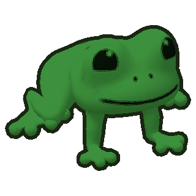
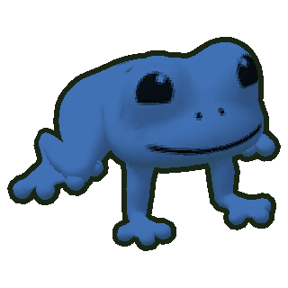
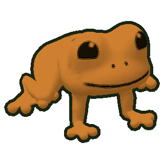
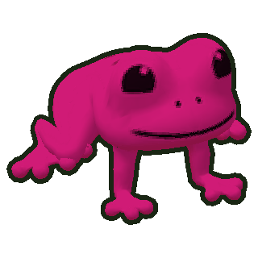

# Style guide — the Pond style

How every dialog, button, chip and readout in the game **looks**: its colours,
outlines, shadows, corners, type and motion. Where a screen page says *where*
something goes and how big it is, this page says what it is drawn in.

The look follows Connor's art. The splash, the 3D frog, the log, the lily pads
and the drifting water are a bright, outlined storybook pond, and until this page
the dialogs were still in the grey wireframe palette that every mockup started
from. This is the one written look that replaces it — **direction A,
"Storybook pond"**, chosen by Derek on
[#524](https://github.com/derekwinters/connor-multiplying-frogs/issues/524).
Every colour here is sampled from art that already exists, so a dialog reads as
part of the same pond rather than as a box laid over it.

**This is a design saved for later.** Nothing on this page is built yet. Each
restyle gets its own build issue in v0.8, blocked by the wireframe issue.

## Scope

| Screen | What this page does to it | Drawn in the new style |
| --- | --- | --- |
| [End-game confirm](end-game-confirm.md) | Restyled | [`end-game-confirm.html`](mockups/end-game-confirm.html) |
| [Settings dialog](settings-dialog.md) | Restyled, with the title as a name-tab | [`settings-dialog.html`](mockups/settings-dialog.html) |
| [Answer result](answer-result.md) | Restyled, right and wrong | [`answer-result-right.html`](mockups/answer-result-right.html), [`answer-result-wrong.html`](mockups/answer-result-wrong.html) |
| [A player has won](player-won.md) | Restyled, the frog drawn as itself | [`player-won-first.html`](mockups/player-won-first.html), [`player-won-later.html`](mockups/player-won-later.html) |
| [Working-out grid](working-out-grid.md) | Restyled, grid and keypad | the five agreed `working-out-grid-*.html` files |
| [Game over](game-over.md) | Restyled, on pond water, frogs in the rows | [`game-over.html`](mockups/game-over.html) |
| [Game board](game-board.md) | The **lane chips** only | [`game-board.html`](mockups/game-board.html), [`game-board-wide.html`](mockups/game-board-wide.html) |
| [Roll and card](roll-and-card.md) | **Not restyled — pending redesign** as the turn panel (three piles and a card flip, [#402](https://github.com/derekwinters/connor-multiplying-frogs/issues/402)). That wireframe is drawn in this style from the start. | — |
| [Pile card](shared-components.md#pile-card) | Drawn in this style from the start ([#401](https://github.com/derekwinters/connor-multiplying-frogs/issues/401)): a pond back with two lily pads and a log, a white front | [`pile-card.html`](mockups/pile-card.html) |
| [Title screen](title-screen.md) | Not touched. It is Connor's splash art, handled on its own page. | — |
| [Game setup](game-setup.md), [How to play](how-to-play.md) | Not redrawn by this page. They pick up the new [Button](shared-components.md#button) through the shared component, and their own elements keep their current drawings until each is restyled under its own wireframe. | — |

## Invariants

**Invariant:** every colour a view draws is one of the named colours on this
page, declared once in one shared place and referenced by name. No view keeps a
hex value of its own. Today the same handful of hex values is pasted into ten
views, which is how three greens happen.
**Invariant:** the style changes how things look, never where they are or how
big they are. Every size, touch target, gap, word and button order on every
screen page stands, except the handful this page lists as changing — and each
of those is also written on its screen page.
**Invariant:** no shadow is blurred. A shadow is a solid offset shape, the way
the splash art draws one.
**Invariant:** a frog is never shown as a coloured dot. Wherever the game names a
player on a restyled screen, it shows that player's frog, in their colour, beside
the name.
**Invariant:** a dialog carries at most one decorative element, and decoration is
never drawn behind words.
**Invariant:** nothing on this page is fetched. The fonts are bundled in the app,
with their licence beside them.

## Requirements

Each is one behaviour, numbered so a build issue and its test can name it.

- **PS-1 — One palette.**  The colours below are declared once,
  as named constants, in one shared colour class. Every restyled view reads them
  from there.
- **PS-2 — Ink outlines.**  Every panel, button, chip, key,
  cell and badge is outlined in `Ink`: `OutlinePanel` on panels, `OutlineButton`
  on buttons and keys, `OutlineChip` on chips.
- **PS-3 — Solid shadows.**  A panel drops `ShadowPanel`; a
  primary button stands on a `ButtonLipDepth` lip in `LeafLip`; every other
  shadow is the solid offset its table row gives. None is blurred.
- **PS-4 — Corners.**  Panels `DialogRadius` (44 px), buttons
  `ButtonRadius` (30 px), chips fully round (half their height).
- **PS-5 — Two fonts.**  `FontDisplay` (Fredoka) for titles,
  button labels, chip names and every number in a sum; `FontBody` (Nunito) for
  sentences. Titles and button labels are semibold.
- **PS-6 — Bundled, licensed, offline.**  Both fonts ship inside
  the app under the SIL Open Font License, with the licence text shipped beside
  them. Nothing is downloaded at any time.
- **PS-7 — The scrim is deep pond.**  A dialog dims what is
  behind it with `DeepPond` at `DialogScrimOpacity` (0.60), so the board still
  reads as water.
- **PS-8 — The panel grows as it fades in.**  On opening, the
  panel fades in over `DialogFadeDuration` (0.15 s) and grows from
  `DialogOpenScale` (94 %) to full size over the same time. No slide, no bounce,
  no overshoot.
- **PS-9 — The press sinks into the lip.**  A pressed button
  moves down `ButtonPressOffset` (8 px) and its lip shrinks by the same amount, so
  it reads as pushed in rather than moved.
- **PS-10 — Frogs, not dots.**  Wherever a restyled screen names
  a player, the player's frog render (`FrogRender`) in their colour stands beside
  the name. The frog stands free: no circle, no disc, no box behind it.
- **PS-11 — The active chip is heavier, not ringed.**  The chip
  of the player whose turn it is has `OutlineChipActive` (7 px) and the
  `ActiveFill` wash. It never gets a second ring.
- **PS-12 — One decoration.**  At most one decorative element
  per dialog. Today there are two in the whole game: the Settings name-tab and
  the winner's sun rays.

## The palette

Sampled from the art: the splash gives the outline and the greens, the board
gives the water, the log gives the warm accent.

| Name | Constant | Value | Used for |
| --- | --- | --- | --- |
| Ink | `Ink` | `#1A2614` | Every outline, titles and labels. The splash's outline colour. |
| Ink soft | `InkSoft` | `#3B4A33` | Sentences — a dialog's body text |
| Moss | `Moss` | `#56634F` | Quiet second lines: a chip's pad count, a standings row's progress |
| Reed | `Reed` | `#6B7A62` | The version string, the quietest line in the game |
| Paper | `Paper` | `#FFFDF4` | Panel fill, the board's lane chips, standings rows. The splash's cloud white. |
| White | `White` | `#FFFFFF` | A dialog chip's fill, a grid cell, a key; a primary button's label; the marks in a badge |
| Leaf | `Leaf` | `#2C8C1C` | The one primary button; the right-answer badge |
| Leaf lip | `LeafLip` | `#1B5E10` | The solid lip under a primary button |
| Leaf pressed | `LeafPressed` | `#257716` | A primary button's fill while pressed |
| Lime | `Lime` | `#87BD01` | Highlights: the Settings name-tab, and the working-out grid's focused cell. The splash's "FROGS" lime `#8EC701`, darkened 5 % |
| Active fill | `ActiveFill` | `#F2FADF` | The chip, or the standings row, that is the one that matters right now |
| Lily wash | `LilyWash` | `#EEF8DC` | The card readout pill and the answer row's cells on the working-out grid |
| Sun rays | `SunRays` | `#E6F5C2` | The winner's rays — the one place it appears |
| Pond | `PondWater` | `#9FD8F2` | Unchanged — the board's water, [game board](game-board.md#colours). Now also under game over. |
| Deep pond | `DeepPond` | `#092E4A` | The scrim, at `DialogScrimOpacity` |
| Log end | `LogEnd` | `#D98A2B` | Warm accent — the log's cut end. Reserved: no restyled screen uses it yet. |
| Log carve | `LogCarve` | `#F4DDB8` | The pile's name carved on a [pile card](shared-components.md#pile-card)'s log, the pale wood under the bark — the one place it appears |
| Berry | `Berry` | `#C8361E` | Destructive buttons, and the wrong-answer badge |

The four frog colours are unchanged — [`FrogGreen`, `FrogBlue`, `FrogOrange`,
`FrogPink`](shared-components.md#frog-colours) — and are not restated here.

**This is the palette decision the mockups have been waiting for.** Every mockup
in [`mockups/`](mockups/index.md) used to say its colours were placeholders and
that the palette is an `area:art` call. For the dialogs, the buttons, the chips
and game over, this is that call. The frog colours, the board's surfaces and the
splash are still decided where they always were.

Pairs worth having measured (luminance contrast and ΔE, the same measures as
[keeping the frogs visible](game-board.md#keeping-the-frogs-visible)):

| Pair | Contrast | Bar |
| --- | --- | --- |
| `White` label on `Leaf` | 4.31 : 1 | 3 : 1 for 44 px semibold text — clears |
| `Berry` label on `Paper` | 5.15 : 1 | 4.5 : 1 — clears |
| `InkSoft` body on `Paper` | 9.31 : 1 | 4.5 : 1 — clears |
| `Lime` focus on a `White` cell | 2.26 : 1, ΔE 86.3 | 1.9 : 1 and ΔE 30 — clears |
| `Lime` focus on a `LilyWash` answer cell | 2.05 : 1, ΔE 71.2 | 1.9 : 1 and ΔE 30 — clears |
| `Ink` digit on `Lime` | 6.99 : 1 | 4.5 : 1 — clears |
| `LogCarve` name on the log's bark (its average, `#50331E`) | 8.66 : 1, with a 3 px `Ink` edge besides | 3 : 1 for 38 px semibold text — clears |

**There is one lime.** The splash's own `#8EC701` is 1.85 : 1 against the
answer row's `LilyWash`, just under the
[separability bar](working-out-grid.md#what-focus-looks-like) the grid's focused
cell must clear, so Derek took it 5 % darker, to `#87BD01`, and made that the
palette's only `Lime` — the Settings name-tab uses the same value as the focus
([#525](https://github.com/derekwinters/connor-multiplying-frogs/issues/525)).
The difference from the splash lime is 1.11 : 1 / ΔE 4.7: the same colour to
the eye.

## Named constants

### Lines, shadows and corners

| Element | Constant | Value |
| --- | --- | --- |
| Panel outline | `OutlinePanel` | 6 px `Ink` |
| Button and key outline | `OutlineButton` | 5 px `Ink` (`Berry` on a destructive button) |
| Chip outline | `OutlineChip` | 4 px `Ink` |
| The active chip's outline | `OutlineChipActive` | 7 px `Ink` |
| Panel shadow | `ShadowPanel` | 14 px straight down, `Ink` at 45 %, no blur |
| Primary button lip | `ButtonLipDepth` | 10 px of `LeafLip`, outlined in `Ink` at `OutlineButton` |
| Secondary button shadow | `ShadowButtonSecondary` | 6 px down, `Ink` at 25 % |
| Destructive button shadow | `ShadowButtonDestructive` | 6 px down, `Berry` at 25 % |
| Key shadow | `ShadowKey` | 8 px down, `Ink` at 30 % |
| Badge shadow | `ShadowBadge` | 8 px down, `Ink` at 35 % |
| Lane chip and standings row shadow | `ShadowChip` | 6 px down (8 px on a standings row), `Ink` at 30 % |
| Panel corner | `DialogRadius` | 44 px |
| Button corner | `ButtonRadius` | 30 px |
| Key corner | `KeypadKeyRadius` | 30 px |
| Chip corner | — | half the chip's height: fully round |

`DialogRadius`, `ButtonRadius` and `KeypadKeyRadius` are the screen pages'
constants with new values; they are listed here so the look can be read in one
place, and the screen pages are where the code takes them from.

### Type

| Element | Constant | Value |
| --- | --- | --- |
| Display face | `FontDisplay` | Fredoka — titles, button labels, chip names, every number in a sum, keypad keys |
| Body face | `FontBody` | Nunito — sentences, second lines, the About block's credit |
| Title and button-label weight | `WeightDisplay` | SemiBold (600) |
| Body weight | `WeightBody` | SemiBold (600) |
| Quiet second-line weight | `WeightQuiet` | ExtraBold (800) at its small size, so 24 px still reads at arm's length |

**This answers [#422](https://github.com/derekwinters/connor-multiplying-frogs/issues/422)**
— whether button labels are bold, as the mockups drew them, or regular, as the
app draws them. Neither: they are **semibold Fredoka**, a face the app does not
have yet. Every label width measured off an older mockup was measured in the
system font at 700 and is now only an estimate; the buttons already
[widen to their labels](shared-components.md#button), so nothing clips, but the
widths are re-measured when the fonts land. #422 stays open until a build PR
closes it.

Both faces are free under the SIL Open Font License. The licence lets them be
bundled and shipped inside the app as long as the licence text goes with them,
which is [PS-6](#ps-6). Fredoka is already committed once, beside the title
screen's mockup, at
[`images/title-screen/fonts/`](images/title-screen/fonts/OFL.txt); the restyled
mockups load it from there by relative path. Nunito is not committed yet — the
mockups name it and fall back to the system sans-serif, so the sentences in them
are an approximation of the face until it is.

### Motion

| Element | Constant | Value |
| --- | --- | --- |
| Open and close fade | `DialogFadeDuration` | 0.15 s (unchanged) |
| The panel's size when it starts to open | `DialogOpenScale` | 0.94 |
| Press travel | `ButtonPressOffset` | 8 px |

The panel grows from `DialogOpenScale` to 1 over the same `DialogFadeDuration`
as the fade, easing out, and never past full size. **Opening only**: the
decision was *"the fade plus a small grow"* for the open, and closing stays the
fade it is today. The scrim fades and never scales.

### Chips and frogs

| Element | Constant | Value |
| --- | --- | --- |
| The frog render | `FrogRender` | One per colour, 320 × 320, transparent, the 3D model at three-quarter view — [`images/frogs/`](#the-frog-renders) |
| The frog in a dialog chip | `PlayerChipFrogSize` | 108 × 80 px, the render scaled to fit |
| The frog in a standings row | `StandingsFrogSize` | 150 × 120 px |
| The frog on [a player has won](player-won.md) | `WonFrogSize` | 220 × 220 px |
| Name on a board lane chip | `LaneChipNameSize` | 34 px, `FontDisplay` semibold |
| The ink outline round that name | `LaneChipNameOutline` | 5 px `Ink` stroke drawn behind the letters, so 2.5 px shows outside them |
| Letter spacing of that name | `LaneChipNameTracking` | 0.03 em |
| Padding inside a lane chip | `LaneChipPaddingX` | 20 px (17 px on the active chip) |
| Room the name has | `LaneChipNameColumn` | 208 px, fixed |

The chip rules themselves — what a dialog chip holds, how it grows, what a lane
chip holds — live on the component, in
[player chip](shared-components.md#player-chip).

### Decoration

| Element | Constant | Value |
| --- | --- | --- |
| Settings name-tab | see [settings dialog](settings-dialog.md#named-constants) | `Lime`, outlined, straddling the panel's top edge |
| The winner's sun rays | see [a player has won](player-won.md#named-constants) | `SunRays`, 15 rays, behind the frog |

## The frog renders

{ width="120" }
{ width="120" }
{ width="120" }
{ width="120" }

The approved 3D frog — [the frog piece](game-board.md#the-frog-piece) — rendered
at three-quarter view, once per frog colour, on a transparent 320 × 320 canvas.
The frog itself fills about 304 × 238 of it. They are committed under
[`images/frogs/`](images/frogs/frog-green.png) so the mockups can load them by
relative path and open with no network.

They are documentation images, not the game's assets. How the shell gets a
frog into a chip — the same renders imported as sprites, or the model rendered
live — is the build issue's question and is not decided here.

## How it gets built

Each restyled screen page has a **"What the Pond style changed here"** table,
or says on the page what moved, and that is the list its build issue works
from. Until those issues land, the code still declares the old values and some
of the old names — `PlayerSwatchDiameter`, `PlayerChipActiveRing`,
`WonFrogDiameter`, `StandingsSwatchDiameter` and the rest — and the built
dialogs still look the way they do today. That lag is expected: this page is a
design saved for v0.8, not a description of the current build.

The fonts and frog renders that the game itself needs are part of those build
issues. Nothing under `Assets/` is touched by this page.

## Mockup

Every row of [Scope](#scope) that says *drawn in the new style* is redrawn at
1920 × 1200. The old drawings' words, sizes and positions are kept; only the
look moved, except where a screen page says otherwise.

## Open questions

None. The two this page opened with are settled by Derek:

- **The working-out grid's focus fill** —
  [#525](https://github.com/derekwinters/connor-multiplying-frogs/issues/525):
  keep the separability bar; the focus is `Lime` `#87BD01`, the answer row is
  `LilyWash` `#EEF8DC`, and the focused cell keeps its neighbours' outline. See
  [working-out grid](working-out-grid.md#what-focus-looks-like).
- **A ten-letter name on a board lane chip** —
  [#526](https://github.com/derekwinters/connor-multiplying-frogs/issues/526):
  the name is 34 px in a fixed 208 px column, with 20 px padding (17 px when the
  active chip's outline is thicker), and a name that still does not fit
  truncates with an ellipsis. See [player chip](shared-components.md#player-chip).
